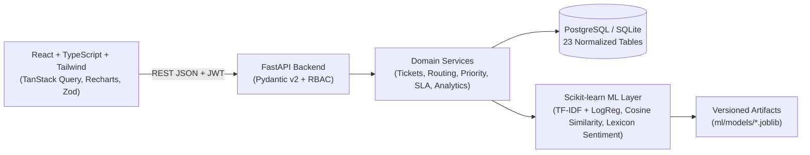

# QRYVANTA — Intelligent Customer Support Operations & Ticket Resolution Platform

**Understand every request. Route it right. Resolve it better.**

QRYVANTA is a full-stack customer support operations and ticket resolution platform built with **React + TypeScript**, **FastAPI + SQLAlchemy**, and **Scikit-learn**. It combines an end-to-end multi-role ticketing workflow with explainable NLP classification, confidence-based routing, independent urgency detection, TF-IDF cosine-similarity duplicate discovery, business-hours SLA tracking, human-in-the-loop feedback analytics, and controlled model versioning.

> **Decision-Support Notice:** Classification, urgency, sentiment, and assignment predictions in QRYVANTA are decision-support recommendations designed to assist support personnel and require human review where appropriate.

---

## Table of Contents

1. [Problem Statement & Motivation](#problem-statement--motivation)
2. [Objectives & Intended Users](#objectives--intended-users)
3. [Key Features](#key-features)
4. [Screenshots](#screenshots)
5. [Architecture Overview](#architecture-overview)
6. [Technology Stack](#technology-stack)
7. [Database Design Summary](#database-design-summary)
8. [Machine Learning Methodology](#machine-learning-methodology)
9. [API Overview](#api-overview)
10. [Project Directory Structure](#project-directory-structure)
11. [Prerequisites & Windows Setup](#prerequisites--windows-setup)
12. [Quick Start & Demo Accounts](#quick-start--demo-accounts)
13. [Environment Configuration](#environment-configuration)
14. [Dataset Sources & Licensing](#dataset-sources--licensing)
15. [Example Usage](#example-usage)
16. [Testing & Verification Status](#testing--verification-status)
17. [Security & Privacy Considerations](#security--privacy-considerations)
18. [Known Limitations & Future Enhancements](#known-limitations--future-enhancements)
19. [Learning Outcomes & Portfolio Skills](#learning-outcomes--portfolio-skills)
20. [License](#license)

---

## Problem Statement & Motivation

Support teams handling multi-channel inquiries face recurring operational friction: manual triage slows initial response times, rule-of-thumb routing drops ambiguous requests in the wrong queues, angry customer tone is mistakenly equated with critical system outages, duplicate tickets waste agent capacity, and SLA compliance erodes when deadlines ignore business hours and holidays.

QRYVANTA demonstrates how practical, transparent machine learning and disciplined workflow engineering work together inside a real multi-role enterprise application—running 100% locally without paid AI APIs.

---

## Objectives & Intended Users

QRYVANTA enforces backend role-based access control across **four distinct roles**:

| Role | Core Capabilities |
|---|---|
| **Customer** | Dedicated simplified Customer Portal (`Home`, `Submit a Complaint`, `My Complaints`, `Help Centre`, `Account`): submit complaints in plain language with attachments, track progress via a 4-step timeline and customer-friendly statuses, reply to support, browse published Help Centre articles, rate resolutions, and reopen complaints—without ever seeing internal ML, SLA, or operational metrics. |
| **Support Agent** | Work assigned & authorized department queues, send public replies, record private internal notes (never exposed to customers), inspect ML predictions, submit classification corrections with reasons, review similar tickets, and insert Knowledge Base articles. |
| **Support Manager** | Monitor team KPIs and SLA compliance, assign/reassign tickets (individually or in bulk), override routing, review low-confidence predictions, run CSV bulk ticket imports, analyze department/agent/CX metrics, and trigger controlled model retraining. |
| **Administrator** | Manage users & roles, configure departments, hierarchical categories/subcategories, routing rules, confidence thresholds, SLA policies, business hours, holidays, Knowledge Base content, model activation, and audit logs. |

---

## Key Features

- **End-to-End Ticket Lifecycle**: Submission with Zod validation & attachment uploads, chronological conversation, private internal notes, assignment history, event timeline, resolution, reopening with reason, and satisfaction ratings.
- **Multi-Platform / Company Portal Intake & Pre-Verification Handoff**: Customers select the target **Platform / Portal** (*E-Commerce, SaaS / Software, Fintech / Payments, Logistics / Courier, Hardware & Devices*), choose the **Company**, and enter their **External Order / Return / Transaction ID**. QRYVANTA support agents verify evidence (`Unverified → Under verification → Verified ready → Reported to company → Company acknowledged → Company resolved`), record a direct recommended company action, and export a structured **Company Handoff Brief (`.md`/JSON)** so partner companies can resolve claims without redundant investigation.
- **Portal-Wise & Company-Wise Reporting (`/portals`)**: Dedicated dashboard showing stacked status progress per platform portal, pre-verification rates per company, direct filtered queue links, and company registration for managers/admins.
- **Hierarchical Ticket Classification**: TF-IDF (1–2 grams) + balanced Logistic Regression predicting main category, subcategory, confidence score, top 3 alternatives, and top contributing keywords—with a transparent keyword rule-based fallback if no trained model is active.
- **Confidence-Based Department Routing**: Configurable High (`>= 0.80` auto-route), Medium (`0.55–0.79` suggested department for review), and Low (`< 0.55` manual triage) thresholds.
- **Independent Priority & Urgency Detection**: Rule-based urgency scoring decoupled from both ticket category and negative sentiment; displays clear rationale and supports staff overrides with recorded reasons.
- **Duplicate & Related Ticket Discovery**: TF-IDF cosine similarity scoped strictly to the caller's authorized tickets; staff manually link confirmed `duplicate` or `related` records (never auto-merged or auto-closed).
- **Deterministic Agent Assignment Recommendations**: Ranks eligible department agents by availability, open workload vs. capacity limit, and category expertise, showing transparent plain-English reasons.
- **Business-Hours & Holiday SLA Engine**: Calculates exact first-response and resolution deadlines respecting Mon–Fri working hours, configured holidays, and paused time while `awaiting_customer`.
- **Incident Detection & Grouping (`/incidents`)**: Automatically clusters semantically similar open tickets within a rolling time window using TF-IDF cosine similarity into suggested incidents (`Detected → Investigating → Confirmed → Monitoring → Resolved / Dismissed`), reporting **unique affected customers** separately from total ticket counts, common symptoms, timelines, and ticket linking/unlinking.
- **Customer Impact Analysis**: Transparent per-ticket and per-incident impact panel distinguishing unique affected customers from repeat complaints, showing customer open/prior history and linked incidents (zero fabricated LTV/revenue).
- **Deterministic SLA Breach Risk & Workload Optimization (`/operations`)**: Rule-based SLA breach risk scoring (`Low`, `Moderate`, `High`, `Critical`) with transparent contributing factors and recommended actions; manager workload view categorizing agents into Available / Nearing Capacity / Overloaded alongside unassigned high-priority queues with 1-click explainable agent approval and 7-day department backlog momentum.
- **Resolution Intelligence, Knowledge Gaps & Effectiveness (`/resolution-intelligence`)**: Retrieves genuine previously resolved similar tickets (with strict customer isolation), lets agents reuse verified fixes in replies and rate recommendations (`Helpful` / `Partially helpful` / `Not helpful`), detects undocumented Knowledge Gaps with 1-click **unpublished** draft KB creation, and tracks First Contact Resolution (FCR), reopen rate, and post-closure recurrence.
- **Human-in-the-Loop Feedback & Model Centre**: Records every staff correction with rationale, tracks correction rates and mismatch trends, and supports controlled retraining & version activation with zero-leakage held-out evaluation.
- **Operational Intelligence & Analytics**: Real database-calculated metrics, date filtering, z-score category demand spike alerts, reopened-ticket analysis, Knowledge Base suggestions, bulk CSV import with column mapping, and CSV exports.

---

## Screenshots

All screenshots below were captured directly from the running QRYVANTA application (`1440x900`).

### Customer Portal — Home ("How can we help you today?")


### Customer Portal — Simplified Complaint Submission


### Customer Portal — My Complaints & Complaint Tracking Timeline


### Customer Portal — Help Centre (Published Articles & Contact Support)


### Operations Overview (Attention Required, Incident Summary & Live Insights)


### Incident Centre (TF-IDF Grouping, Unique Affected Customers & Investigation)


### Risk & Workload Operations (SLA Breach Risk, Capacity Bands & Manager Approvals)


### Resolution Intelligence & Knowledge Gaps (FCR, Verified Resolutions & Draft KB)


### Portals, Companies & Verification Handoff Reporting


### Ticket Submission with Platform, Company & External Reference Selection


### Ticket Queue & Portal / Verification Filtering


### Three-Column Ticket Detail Workspace (Conversation, Private Notes, Verification Handoff, ML Intelligence & SLA)


### Operational Intelligence & Live Classification Test Bench


### Model Centre (Held-Out Metrics, Per-Category Breakdown & Controlled Retraining)


### Workspace Login & Local Demo Role Selector


---

## Architecture Overview



See [docs/ARCHITECTURE.md](docs/ARCHITECTURE.md) and [docs/DATABASE_SCHEMA.md](docs/DATABASE_SCHEMA.md) for detailed diagrams and table specifications.

---

## Technology Stack

- **Frontend**: React 19, TypeScript, Vite 6, Tailwind CSS v4, React Router 7, TanStack Query 5, Recharts, Lucide React, React Hook Form, Zod.
- **Backend**: Python 3.11+ (verified on Python 3.14), FastAPI, Pydantic v2, SQLAlchemy 2, Alembic, `bcrypt`, `PyJWT`, Uvicorn.
- **Database**: PostgreSQL (primary, Docker Compose & `psycopg[binary]` ready) with SQLite local development fallback (`PRAGMA foreign_keys=ON`).
- **Machine Learning**: Scikit-learn, Pandas, NumPy, Joblib, TF-IDF vectorization, Logistic Regression, Cosine Similarity, Rule-based Lexicon Sentiment.
- **Testing**: Pytest, FastAPI TestClient, Vitest, React Testing Library.

---

## Database Design Summary

23 normalized SQLAlchemy tables covering `users`, `customers`, `departments`, `agents`, `agent_departments`, `categories`, `tickets`, `ticket_messages`, `ticket_assignments`, `ticket_events`, `ticket_predictions`, `ticket_feedback`, `ticket_relations`, `ticket_attachments`, `sla_policies`, `sla_tracking`, `knowledge_articles`, `knowledge_recommendations`, `model_versions`, `routing_rules`, `holidays`, `app_settings`, and `audit_logs`. Full details in [docs/DATABASE_SCHEMA.md](docs/DATABASE_SCHEMA.md).

---

## Machine Learning Methodology

- **PII Anonymization & Normalization**: Strips emails, phone numbers, URLs, and reference IDs prior to TF-IDF vectorization.
- **Zero-Leakage Evaluation**: Exact duplicate texts are dropped prior to splitting, and synthetic template families are partitioned via `StratifiedGroupKFold` so no template variants span training and test sets.
- **Measured Baseline (`v1.0.0`, 459 Train / 117 Held-Out Test)**:
  - **Main-Category Test Accuracy**: `88.89%`
  - **Macro F1**: `88.63%` | **Weighted F1**: `88.45%`
  - **24-Way Subcategory Test Accuracy**: `52.14%` (honestly reflects narrow per-subcategory support and demonstrates why human review is integral).

Full methodology and per-category tables are documented in [docs/ML_METHODOLOGY.md](docs/ML_METHODOLOGY.md).

---

## API Overview

Interactive Swagger UI is served at `http://127.0.0.1:8000/docs`. Major endpoint groups:

- `/api/auth/*` — Registration, login, profile management, logout.
- `/api/tickets/*` — Full CRUD, replies, attachments, assignment, reclassification, close/reopen, ratings, relations, bulk actions, CSV export/import.
- `/api/intelligence/*` — Single/bulk classification, prediction audit, similarity search, feedback analytics.
- `/api/departments/*` & `/api/agents/*` — Queue management, workload tracking, deterministic recommendations.
- `/api/analytics/*` — Overview, tickets, departments, agents, SLA, classification, customer experience, CSV report export.
- `/api/models/*` — Version history, active model, metrics inspection, controlled retraining, activation.
- `/api/settings`, `/api/sla/policies`, `/api/categories`, `/api/routing-rules`, `/api/holidays`, `/api/users`, `/api/knowledge`, `/api/audit-logs`.

Complete reference in [docs/API_DOCUMENTATION.md](docs/API_DOCUMENTATION.md).

---

## Project Directory Structure

```text
90-days-90-projects-day-25-qryvanta/
├── backend/
│   ├── app/
│   │   ├── main.py              # FastAPI entrypoint, CORS, exception handling
│   │   ├── config/settings.py   # Environment settings
│   │   ├── database/            # SQLAlchemy engine, session, init_db
│   │   ├── models/              # 23 normalized ORM tables
│   │   ├── schemas/             # Pydantic v2 request/response validation
│   │   ├── routers/             # 8 REST API routers
│   │   ├── services/            # Ticket, SLA, Priority, Routing, ML, Analytics, Bulk Import, Audit
│   │   └── utils/               # Filename sanitization & rate limiter
│   ├── migrations/              # Alembic configuration
│   └── requirements.txt
├── ml/
│   ├── preprocessing/           # PII anonymization & text cleaning
│   ├── training/                # Deduplication & group-stratified training pipeline
│   ├── evaluation/              # Held-out test metrics & low-support warnings
│   ├── prediction/              # Joblib inference + keyword fallback
│   ├── duplicate_detection/     # TF-IDF cosine similarity engine
│   ├── sentiment/               # Transparent rule-based lexicon analyzer
│   └── models/                  # Versioned joblib artifacts
├── frontend/
│   ├── src/
│   │   ├── components/          # Reusable editorial UI components
│   │   ├── layouts/             # Horizontal-navigation AppLayout
│   │   ├── pages/               # All 10 screens + Login
│   │   ├── hooks/               # Auth & Toast contexts
│   │   ├── services/            # Typed API & file download client
│   │   ├── types/               # TypeScript interfaces
│   │   ├── styles/              # Editorial design tokens & Tailwind CSS
│   │   └── __tests__/           # Vitest + React Testing Library suite
│   └── package.json
├── data/
│   ├── synthetic/               # Reproducible synthetic dataset generator (576 demo rows)
│   └── README.md
├── scripts/                     # train_classifier.py, seed_database.py, evaluate_model.py, import_tickets.py
├── tests/                       # Backend Pytest suite (13 tests)
├── docs/                        # Architecture, Schema, API, ML Methodology, User Guide, Testing, Troubleshooting
├── screenshots/                 # Genuine captured application screenshots
├── docker-compose.yml           # PostgreSQL + Backend + Frontend container setup
├── setup.bat / run.bat / test.bat
├── QUICKSTART.md
├── DEMO_SCRIPT.md
└── README.md
```

---

## Prerequisites & Windows Setup

- **Python** 3.11+ (tested on Python 3.14 on Windows 11)
- **Node.js** 20+ & **npm** 10+ (tested on Node v24.19.0)
- Optional: **PostgreSQL 16+** or **Docker Desktop** (SQLite works automatically out of the box)

### One-Command Windows Setup
```bat
setup.bat
```

### Manual Windows Setup (Two Terminals)

**Terminal 1 — Backend & ML:**
```powershell
python -m venv .venv
.\.venv\Scripts\Activate.ps1
pip install -r backend\requirements.txt
Copy-Item .env.example .env
python scripts\train_classifier.py
python scripts\seed_database.py
uvicorn app.main:app --app-dir backend --host 127.0.0.1 --port 8000 --reload
```

**Terminal 2 — React Frontend:**
```powershell
cd frontend
npm install
npm run dev
```

---

## Quick Start & Demo Accounts

Run `run.bat` and open **http://127.0.0.1:5173** (API Docs: **http://127.0.0.1:8000/docs**).

> **Warning:** Demo accounts use a temporary local development password (`DemoUser#2026`). Change all passwords and `JWT_SECRET_KEY` before deploying outside localhost. All seeded tickets carry `is_demo_data=True` and display a `Demo record` indicator.

| Role | Email | Temporary Dev Password |
|---|---|---|
| Administrator | `admin@qryvanta.local` | `DemoUser#2026` |
| Support Manager | `manager@qryvanta.local` | `DemoUser#2026` |
| Billing Agent | `billing.agent@qryvanta.local` | `DemoUser#2026` |
| Technical Support Agent | `tech.agent@qryvanta.local` | `DemoUser#2026` |
| Logistics Agent | `logistics.agent@qryvanta.local` | `DemoUser#2026` |
| Account Services Agent | `account.agent@qryvanta.local` | `DemoUser#2026` |
| Customer | `customer@qryvanta.local` | `DemoUser#2026` |

---

## Environment Configuration

Copy `.env.example` to `.env` (never commit `.env`):

| Variable | Default | Purpose |
|---|---|---|
| `DATABASE_URL` | `sqlite:///./qryvanta.db` | SQLAlchemy DB URL (`postgresql+psycopg://...` supported) |
| `JWT_SECRET_KEY` | dev placeholder | HS256 signing key (replace with strong random secret in production) |
| `CORS_ORIGINS` | `http://localhost:5173,http://127.0.0.1:5173` | Allowed frontend origins |
| `HIGH_CONFIDENCE_THRESHOLD` | `0.80` | Minimum confidence for automatic department routing |
| `MEDIUM_CONFIDENCE_THRESHOLD` | `0.55` | Minimum confidence for suggested review routing |
| `SIMILARITY_THRESHOLD` | `0.25` | Minimum cosine similarity for related-ticket suggestions |
| `MAX_UPLOAD_SIZE_MB` | `5` | Maximum attachment upload size |

---

## Dataset Sources & Licensing

- **Local Synthetic Dataset (`data/synthetic/synthetic_support_tickets.csv`)**: 576 generated tickets across 8 categories and 24 subcategories, licensed MIT within this repository and explicitly labeled `is_demo_data=True`.
- **External Dataset Readiness**: Supports importing permissively licensed public datasets (e.g., Bitext Customer Support) via CSV bulk import or `train_pipeline.py` after verifying license compliance. See [data/README.md](data/README.md).

---

## Example Usage

**Sample Classification Request (`POST /api/intelligence/classify`):**
```json
{
  "subject": "Double charged on monthly billing statement",
  "description": "My Visa card was charged twice for our October invoice and I need a refund."
}
```
**Sample Output:**
- **Predicted Category / Subcategory**: `Billing and Payments` / `Incorrect Charge`
- **Confidence**: `0.78+` (`ml_model`, `v1.0.0`)
- **Routing Decision**: Routed to `Billing` department
- **Independent Priority**: `high` (*Rule-based urgency assessment: detected duplicate financial charge*)
- **Supporting Sentiment**: `neutral` (`rule_based_lexicon`)

---

## Testing & Verification Status

Run everything on Windows via `test.bat`, or individually:

```powershell
# Backend Pytest (21 tests)
.\.venv\Scripts\pytest.exe tests -v

# Frontend Vitest (11 tests) & Production Build
cd frontend
npm test
npm run build
```

| Check | Status | Details |
|---|---|---|
| Backend Pytest (`tests/`) | **PASS** | 21 / 21 tests passed (Auth/RBAC, Customer Portal Privacy & Field Stripping, Customer Active/Resolved Presets, Published-Only Help Centre Search, Staff Endpoint Blocking, Ticket Lifecycle, Internal Note Privacy, Multi-Platform Portal Intake & Verification Handoff, Incident Detection & Unique Customer Counts, SLA Breach Risk & Workload, Resolution Intelligence & Knowledge Gaps, ML Pipeline, Priority Separation, Cosine Similarity, Business-Hours/Holiday SLA, Analytics, Bulk CSV Import) |
| Frontend Vitest (`frontend/src/__tests__/`) | **PASS** | 11 / 11 tests passed (Login/Register, Staff & Customer Navigation Separation, Customer Home / Simplified Complaint Submission / My Complaints Friendly Statuses / Complaint Tracking Progress Timeline / Help Centre, Staff Ticket Queue, Incident Centre / Risk & Workload / Resolution Intelligence, Semantic Badges & Collapsible Panels) |
| Frontend TypeScript & Vite Build | **PASS** | `tsc --noEmit && vite build` passed with zero errors |
| Live FastAPI End-to-End Probe | **PASS** | Live `uvicorn` verified across `/api/health`, `/api/auth/login`, `/api/analytics/overview`, `/api/tickets`, `/api/models`, `/api/departments`, `/api/agents` |

See [docs/TESTING.md](docs/TESTING.md) for full details.

---

## Security & Privacy Considerations

- Passwords hashed with `bcrypt` (12 salt rounds); plaintext passwords are never stored.
- JWT authentication (`HS256`) with backend role enforcement on every protected endpoint.
- Strict customer isolation: customers cannot access other customers' tickets by ID, list, or similarity search, and never receive `internal` notes or ML internals.
- Safe filename sanitization, extension allowlist, and 5 MB upload cap on attachments.
- In-memory sliding-window rate limiting on authentication endpoints and comprehensive `audit_logs`.

---

## Known Limitations & Future Enhancements

### Known Limitations
- Initial ML model (`v1.0.0`) is trained on 576 synthetic English support records; real production accuracy requires fine-tuning on real historical organization tickets.
- 24-way subcategory test accuracy (`52.14%`) is lower than main-category accuracy (`88.89%`) due to limited per-subcategory sample counts (~19 training examples per subcategory).
- Sentiment analysis uses a transparent rule-based English lexicon rather than a neural transformer model (chosen to keep local Windows installation lightweight with zero GPU or paid API requirements).
- Rate limiting uses in-memory storage (suitable for single-process deployment; use Redis for multi-worker horizontal scaling).

### Future Enhancements
- Optional local sentence-transformer embeddings for multilingual semantic similarity and subcategory disambiguation.
- Inbound email (IMAP/SMTP) and webhook ticketing connectors.
- Background scheduled SLA breach escalation worker (Celery / APScheduler) with email/Slack alert dispatch.
- Full Playwright browser E2E test suite in CI.

---

## Learning Outcomes & Portfolio Skills

- **Software Engineering**: Full-stack React + TypeScript + FastAPI architecture, normalized relational modeling (23 tables), RBAC security, business-hours scheduling algorithms, and automated full-stack testing.
- **Applied NLP & ML**: Leakage-free group-stratified model evaluation, TF-IDF + Logistic Regression hierarchical classification, feature-level explainability, cosine similarity retrieval, and human-in-the-loop retraining loops.
- **Keywords**: `FastAPI`, `React`, `TypeScript`, `Tailwind CSS`, `SQLAlchemy`, `PostgreSQL`, `Scikit-learn`, `TF-IDF`, `Logistic Regression`, `Human-in-the-Loop ML`, `RBAC`, `SLA Engine`, `Pytest`, `Vitest`, `Docker`.

---

## License

MIT License — see [LICENSE](LICENSE).
