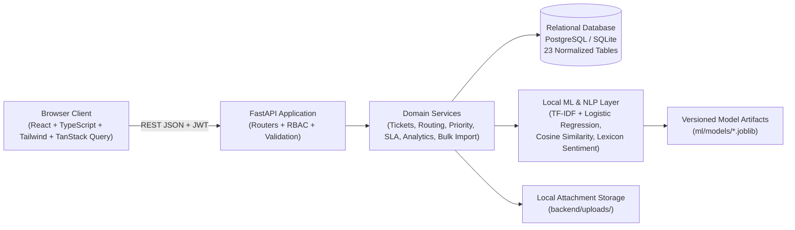

# QRYVANTA — System Architecture

## High-Level Architecture

## Functional Layers

1. **Presentation Layer (`frontend/src/`)**
   - React 19 + TypeScript + Vite + Tailwind CSS v4.
   - Editorial enterprise design system (`#F5F6F4` background, `#FFFFFF` surfaces, `#38685A` accent, horizontal navigation).
   - TanStack Query handles server state caching and invalidation; React Hook Form + Zod validate forms; Recharts renders database-backed operational charts.
2. **API & Authorization Layer (`backend/app/routers/`)**
   - FastAPI routers with Pydantic v2 validation, bcrypt password hashing, JWT authentication (`HS256`), and backend role enforcement (`require_roles`).
   - Strict customer isolation guarantees customers can never access another customer's ticket or view `visibility='internal'` notes.
3. **Domain Services (`backend/app/services/`)**
   - `ticket_service.py`: 12-step submission pipeline, replies, assignment history, reclassification feedback, close/reopen lifecycle.
   - `sla_service.py`: Business-hours and holiday-aware deadline calculator (`add_business_minutes`), pause/resume tracking while `awaiting_customer`, and escalation history.
   - `priority_service.py`: Independent urgency engine decoupled from category and negative sentiment.
   - `routing_service.py`: Confidence-threshold department routing and deterministic workload-balanced agent recommendations.
   - `analytics_service.py`: Consistent KPI aggregation, z-score demand spike detection, and CSV report export.
4. **Machine Learning Layer (`ml/`)**
   - `preprocessing/text_cleaner.py`: PII anonymization (`[email]`, `[phone]`, `[url]`, `[ref_id]`) and text normalization.
   - `training/train_pipeline.py`: Deduplication + group-stratified train/test split (`StratifiedGroupKFold`) preventing template leakage across folds.
   - `prediction/predictor.py`: Loads active `joblib` artifact with top TF-IDF feature explanations; gracefully falls back to a labeled rule-based classifier if no model artifact is active.
   - `duplicate_detection/similarity.py`: TF-IDF cosine similarity scoped to the viewer's authorized ticket set.
   - `sentiment/analyzer.py`: Transparent rule-based lexicon sentiment scorer labeled explicitly as supporting context.
